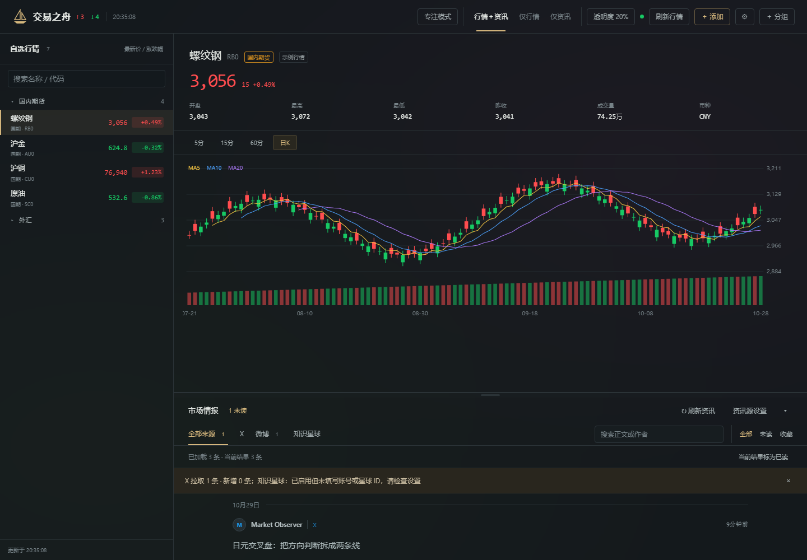
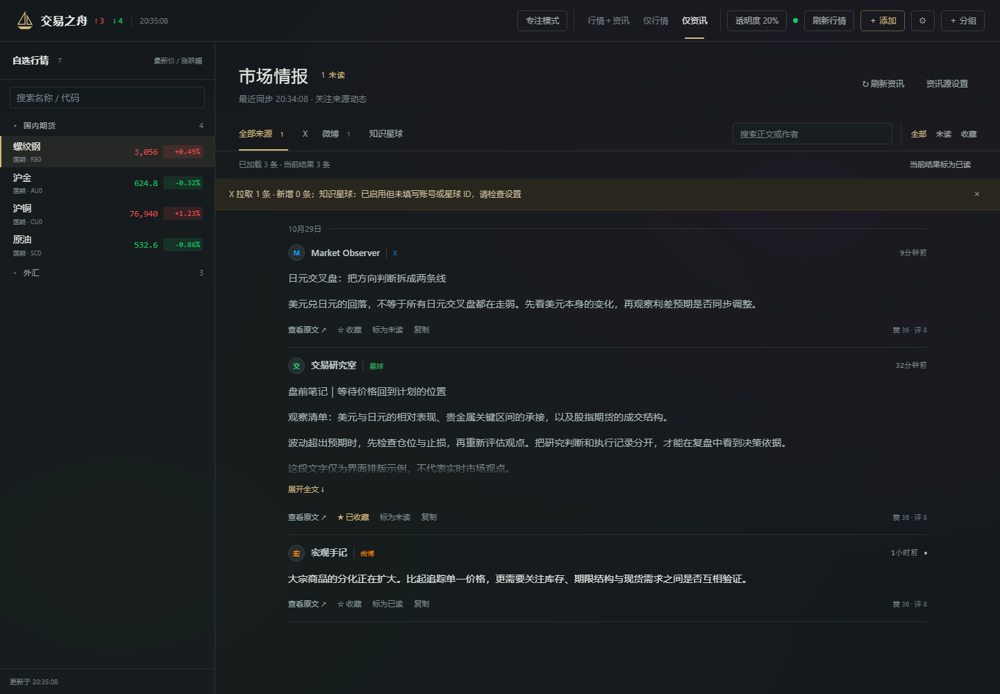

# dsh-tradingboat

[English](README.md) | **中文**

DeepSeek Harness（DSH）的**全屏行情盯盘**插件。把 **国内期货、外盘期货、全球股指、外汇、股票（A股+美股）** 收进同一个面板，自由分组，多源行情 + 内嵌 K 线图；右下角还有一个可选的悬浮胶囊，随时瞄一眼行情。





以上为真实组件使用隔离示例数据渲染的界面预览，不包含账户凭据或付费内容。

## 功能

- **全屏终端式面板** —— 左侧自选列表（分组可折叠、可拖动排序），右侧品种详情（行情指标 + 蜡烛图）。同时在左侧导航注册入口。
- **自由分组** —— 新建 / 重命名 / 上下移动 / 删除分组，任意品种可归入任意分组。首次运行预置五组：**国内期货 / 外盘期货 / 全球股指 / 外汇 / 股票**。
- **全市场混排** —— 国内期货（上期所/大商所/郑商所/能源中心/广期所/中金所）、外盘期货（COMEX/NYMEX/CBOT/ICE）、全球股指、外汇、A股 + 美股，一个列表全放得下。
- **多源、全免 key** —— 宿主端适配器分发到新浪 / 腾讯 / Yahoo，自动回退（见下表）。
- **K 线图** —— 纯手绘 SVG 蜡烛图（不依赖外部 CDN、无 CSP 问题），带 MA5/10/20 与成交量柱；周期：5分 / 15分 / 60分 / 日K。国内期货 K 线走新浪，其余走 Yahoo。
- **涨跌配色** —— 自动（国内红涨绿跌、海外绿涨红跌），或强制 红涨绿跌 / 绿涨红跌。
- **可选悬浮胶囊** —— 右下角胶囊显示涨跌家数与第一组快捷行情，设置里可开关。
- **设置** —— 胶囊开关、涨跌配色、刷新间隔（3/5/10/30 秒）、列表密度。
- **宿主端持久化** —— 自选与设置存 `~/.dsh/dsh-tradingboat/data.json`（原子写 + 时间戳备份 + `.bak` 回退），不用 localStorage，换端口也不丢。

## 数据源（全部免费、无需 Key）

| 资产 | 首选 | 备选 | K 线 |
|---|---|---|---|
| 国内期货 / 股指国债期货 | 新浪 `hq.sinajs.cn` `nf_<代码>0`（一次批量） | 东方财富 | 新浪 `InnerFuturesNewService`（日线 + 5/15/30/60 分） |
| 外盘期货 | 新浪 `hf_XX` | **Yahoo `<SYM>=F`** | Yahoo chart |
| 全球股指 | 新浪 `int_xxx` | Yahoo `^XXX` / 东财 `100.XXX` | Yahoo chart |
| 外汇 | 新浪 `fx_sXXX` | **Yahoo `XXX=X`** | Yahoo chart |
| A股 | 腾讯 `qt.gtimg.cn` | 新浪 / Yahoo | Yahoo chart |
| 美股 | 新浪 `gb_xxx` | **Yahoo** | Yahoo chart |
| 股票搜索 | 腾讯 smartbox（A股/美股 名称+代码） | — | — |

> 一整份混合自选只发**一次**新浪批量请求；只有新浪覆盖不到的品种（部分外盘期货、更多股指）才走 Yahoo 逐个补。

## 安装

以 DSH bundle 形式发布，二选一：

```bash
# A) 从本仓库本地安装
dsh plugin --profile desktop add file:E:/path/to/dsh-tradingboat

# B) 用安装脚本（复制文件 + 登记依赖 + 启用 loader 行，均带备份）
pwsh -File .\install.ps1
```

然后**刷新 Web GUI（Ctrl+R）**加载浏览器半侧。若宿主半侧没自动重载，在 profile 的 `cordis.patch.yml` 里把对应 `insert` 行删掉再加回（或重启一次桌面端）。

## 使用

- 左侧导航点 **交易之舟** 打开面板。
- 点任意行，右侧加载该品种 K 线；顶部 Tab 切换周期。
- **＋ 添加**：按中文名或代码搜索（期货/指数/外汇走内置目录，股票走 smartbox），也可手动选市场 + 填代码添加。
- 分组头悬停显示：上移/下移、重命名、添加到本组、删除。
- **⚙** 打开设置。

### 代码格式

| 市场 | 代码示例 |
|---|---|
| 国内期货 | `RB0` `AU0` `IF0` `M0`（主力连续，后缀 `0`） |
| 外盘期货 | `CL=F` `GC=F` `ES=F` `ZC=F` |
| 全球股指 | `^GSPC` `^DJI` `^IXIC` `^HSI` `^N225` |
| 外汇 | `USDCNY=X` `EURUSD=X` `DX-Y.NYB` |
| A股 | `600519` `000001`（或 `sh600519`） |
| 美股 | `AAPL` `NVDA` |

## 实现

- **宿主半侧**（`lib/main.js`）：Cordis 插件，注册 `/api/dsh-tradingboat/*` 路由（`state` / `quotes` / `kline` / `search` / `news`），持有持久化文件，并完成全部上游抓取（行情与资讯各源解析器 + `AbortSignal` 超时 + 后台轮询）。
- **浏览器半侧**（`lib/client.js`）：DSH `__ModuleLoader__` 的惰性 CJS 模块，注册 `main` 主面板、`sidebar.panellist` 导航入口、`shell.overlay` 悬浮胶囊；React 渲染，图表为手绘 SVG。

## 交易资讯中心（资讯源）

详情区下方内置「交易资讯中心」，把三路信息汇成一条时间线，边看盘边刷：

| 来源 | 接入方式 | 需要准备 |
|---|---|---|
| X（推特） | FxTwitter 免费镜像 `/2/profile/{name}/statuses` | 博主 screenName |
| 微博 | `weibo.com/ajax/statuses/mymblog` | 微博 UID + 登录 Cookie（SUB/SUBP） |
| 知识星球 | `api.zsxq.com/v2/groups/{id}/topics` | groupId + Cookie（zsxq_access_token） |

- 点资讯面板右上 **资讯源设置** 配置并勾选启用各源，可「测试连接」。Cookie 保存在本机配置中，仅随认证请求发送给对应平台，不发送给资讯镜像，不写日志。
- 顶部可切换 **行情＋资讯 / 仅行情 / 仅资讯**；资讯独占模式填满右侧，并暂停 K 线请求。组合模式支持拖拽分隔条调整高度、双击恢复高度。
- 资讯按日期分组，支持来源筛选、作者/正文搜索、全部/未读/收藏筛选、长文展开、已读切换、复制和打开原文。
- 后台按间隔自动轮询（X 5 分钟 / 微博 3 分钟 / 星球 10 分钟）；手动刷新显示拉取数量、新增数量或失败原因。
- Cookie 失效会在面板明确提示（微博 432 / 星球 401），重贴即可。
- 只读、个人使用；知识星球付费内容请遵守平台规则，不要转发。

- 顶部「专注模式」可隐藏左栏；自选支持名称/代码搜索，搜索时会显示折叠分组中的匹配项。设置中的紧凑密度同时作用于行情和资讯。
- 背景透明度支持 0–80% 和四个预设；布局、专注模式与透明度偏好记在当前浏览器来源中，端口改变后可能需要重新选择。
- 「当前结果标为已读」只标记当前加载且符合筛选条件的未读资讯；当前接口最多返回 300 条，不代表全部历史记录。行情手动刷新同时更新 K 线。

## 免责声明

行情来自新浪 / 腾讯 / Yahoo / 东方财富公开接口，仅供个人学习研究，**不构成投资建议**。接口可能变更或限流，插件会在多源间回退但不保证数据准确。插件为只读，不执行任何下单。

## License

MIT © 2026 gary
